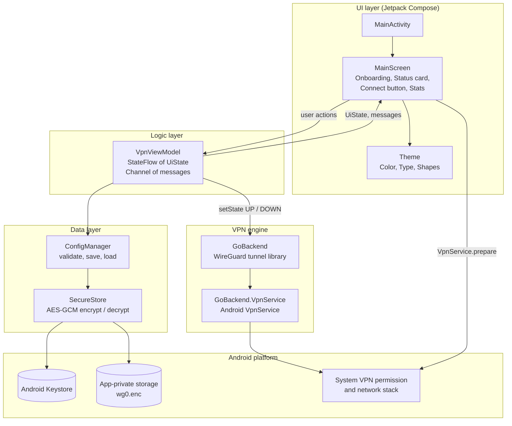
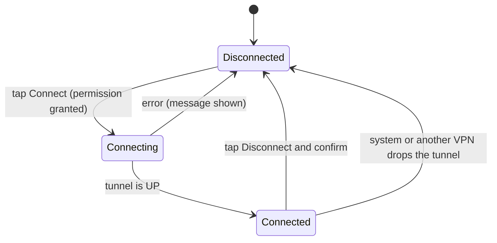
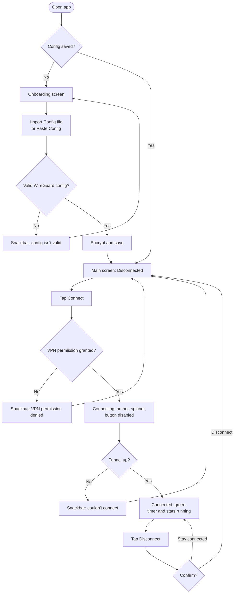
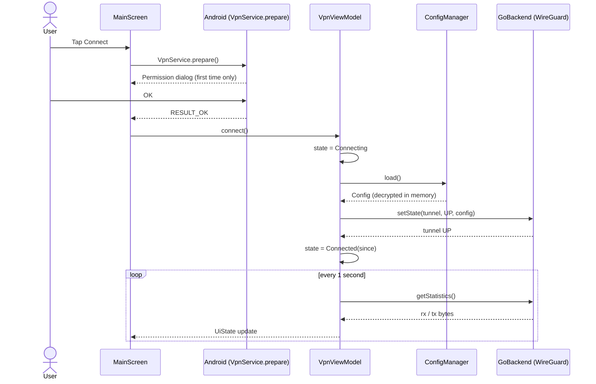
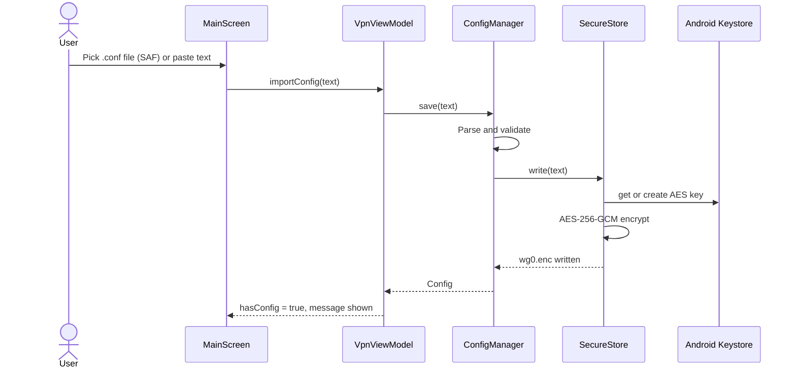

# WG Client

A minimal, modern **WireGuard VPN client for Android**. Import your own `.conf` file, tap one big button, and you're connected. Built with Kotlin, Jetpack Compose and Material 3, on top of the official WireGuard tunnel library.

---

## Table of contents

1. [Features](#1-features)
2. [Technology stack](#2-technology-stack)
3. [Architecture](#3-architecture)
4. [Workflow](#4-workflow)
5. [Project structure](#5-project-structure)
6. [Security and secrets](#6-security-and-secrets)
7. [Installation guide](#7-installation-guide)
   - [Step 1: Server setup](#step-1-server-setup)
   - [Step 2: Prepare the client config](#step-2-prepare-the-client-config)
   - [Step 3: Build the APK](#step-3-build-the-apk)
   - [Step 4: Sign the release](#step-4-sign-the-release)
   - [Step 5: Install on your phone](#step-5-install-on-your-phone)
   - [Step 6: First launch](#step-6-first-launch)
8. [Using the app](#8-using-the-app)
9. [Troubleshooting](#9-troubleshooting)
10. [Common pitfalls](#10-common-pitfalls)

---

## 1. Features

| Area | What you get |
|---|---|
| Connection | One large circular Connect / Disconnect button |
| State feedback | Grey = disconnected, amber + spinner = connecting, green = connected |
| Status | Connection state card with the server address |
| Stats | "Connected for HH:MM:SS" timer, plus download and upload totals |
| Onboarding | Friendly first screen with **Import Config** (file picker) and **Paste Config** |
| Safety | Confirmation before disconnecting, double-tap protection while connecting |
| Errors | Plain-language Snackbar messages (permission denied, invalid config, connection failed) |
| Theming | Light and dark mode that follow the system |
| Accessibility | Screen-reader labels and state descriptions, readable font sizes |
| Privacy | Config encrypted at rest with a key held in the Android Keystore |

---

## 2. Technology stack

| Layer | Technology | Version |
|---|---|---|
| Language | Kotlin | 1.9.24 |
| UI | Jetpack Compose + Material 3 | Compose BOM 2024.06.00 |
| Compose compiler | `kotlinCompilerExtensionVersion` | 1.5.14 (must match Kotlin) |
| State management | ViewModel + Kotlin `StateFlow` / `Channel` | Lifecycle 2.8.3 |
| Concurrency | Kotlin Coroutines | via Lifecycle |
| VPN engine | WireGuard tunnel library (`com.wireguard.android:tunnel`) | 1.0.20230706 |
| Java API support | Core library desugaring (`desugar_jdk_libs`) | 2.0.4 |
| Encryption | Android Keystore, AES-256-GCM | Platform API |
| Build | Gradle (Kotlin DSL) with Android Gradle Plugin | Gradle 8.7, AGP 8.5.2 |
| JDK | OpenJDK / Oracle JDK | 17 |
| Android | minSdk / targetSdk / compileSdk | 24 / 34 / 34 |

**Why core library desugaring?** The WireGuard library uses Java 8+ APIs (such as `java.time`) that are missing on older Android versions. Desugaring back-ports them. Without it the build fails.

---

## 3. Architecture

The app follows a simple layered **MVVM** design: the UI observes state, the ViewModel owns the logic, and the data layer handles storage.



### Layer responsibilities

| Layer | Class | Responsibility |
|---|---|---|
| UI | `MainActivity` | Hosts the Compose content; requests the notification permission on Android 13+ |
| UI | `MainScreen` | Renders onboarding or the main screen; launches the file picker and the VPN permission dialog |
| UI | `ui/theme/*` | Light and dark color schemes, typography, shapes, and the state-driven button colors |
| Logic | `VpnViewModel` | Single source of truth. Exposes `StateFlow<UiState>` and a one-shot message channel; starts and stops the tunnel; polls traffic stats once per second |
| Data | `ConfigManager` | Parses and validates the `.conf` with the WireGuard parser, then saves or loads it |
| Data | `SecureStore` | Encrypts the config before writing and decrypts it on read. Key never leaves the Keystore |
| Engine | `GoBackend` | WireGuard's userspace implementation. Brings the tunnel up and down and reports statistics |

### State model



`ConnectionState` is a sealed interface: `Disconnected`, `Connecting`, `Connected(since)`. The button color, icon label, status text, timer and stats are all derived from it.

---

## 4. Workflow

### 4.1 End-to-end user flow



### 4.2 Connect sequence



### 4.3 Config import and storage



---

## 5. Project structure

```
VPN_Project/
├── app/
│   ├── build.gradle.kts            App module: SDK versions, Compose, WireGuard, desugaring, signing
│   └── src/main/
│       ├── AndroidManifest.xml     Permissions + VPN service declaration
│       ├── java/com/vpnproject/wgclient/
│       │   ├── MainActivity.kt         Entry point, hosts Compose content
│       │   ├── data/
│       │   │   ├── ConfigManager.kt    Validate, save and load the config
│       │   │   └── SecureStore.kt      Keystore-backed AES-GCM encryption
│       │   ├── vpn/
│       │   │   └── VpnViewModel.kt     Tunnel control, ConnectionState, UiState, stats
│       │   └── ui/
│       │       ├── MainScreen.kt       Onboarding, status card, connect button, dialogs
│       │       └── theme/
│       │           ├── Color.kt        Palette and state colors
│       │           ├── Theme.kt        Light/dark scheme, shapes, button colors
│       │           └── Type.kt         Typography
│       └── res/
│           ├── drawable/ic_launcher.xml
│           └── values/{strings,themes}.xml
├── gradle/wrapper/                 Gradle wrapper (pins Gradle 8.7)
├── build.gradle.kts                Root build: plugin versions
├── settings.gradle.kts             Repositories and module list
├── gradle.properties               Gradle and AndroidX flags
├── gradlew, gradlew.bat            Wrapper scripts
├── keystore.properties.example     Template for signing config (no real values)
├── .gitignore                      Excludes secrets, build output, *.conf, *.enc
└── README.md                       This file
```

Files that exist only on your machine and are never committed: `keystore.properties`, `local.properties`, the `.jks` keystore.

---

## 6. Security and secrets

- **Nothing sensitive is hard-coded.** No keys, passwords or server addresses appear in the source.
- **Your WireGuard config is encrypted at rest.** The config (which contains your private key) is stored as `wg0.enc` in app-private storage, encrypted with AES-256-GCM. The AES key is generated inside the Android Keystore and cannot be exported.
- **Decrypted only in memory**, only while connecting.
- **No backups and no logging.** `allowBackup` is off and the config is never logged.
- **Signing credentials stay out of the repo.** Provide them in a git-ignored `keystore.properties` or in environment variables (see [Step 4](#step-4-sign-the-release)).
- **Keep the keystore outside the project folder** and back it up. You need the same key to publish updates.
- **Minimal permissions:** `INTERNET`, `FOREGROUND_SERVICE`, `POST_NOTIFICATIONS`, plus the VPN service bound with `BIND_VPN_SERVICE`.

---

## 7. Installation guide

### Prerequisites

| You need | Notes |
|---|---|
| A WireGuard server with a public IP | A small Linux VPS is enough |
| An Android phone | Android 7.0 (API 24) or newer |
| A Windows, macOS or Linux PC | Only to build the APK |
| JDK 17 | Needed by the Android Gradle Plugin |
| Android SDK | Platform 34 and Build-Tools 34.0.0 (or Android Studio) |

### Step 1: Server setup

Example for Ubuntu or Debian. Run as root on your server.

```bash
# 1. Install WireGuard
apt update && apt install -y wireguard

# 2. Generate server and client key pairs
cd /etc/wireguard
umask 077
wg genkey | tee server_private.key | wg pubkey > server_public.key
wg genkey | tee client_private.key | wg pubkey > client_public.key

# 3. Enable IP forwarding
echo "net.ipv4.ip_forward=1" >> /etc/sysctl.conf && sysctl -p
```

Create `/etc/wireguard/wg0.conf` on the server (replace the placeholders and `eth0` with your public network interface):

```ini
[Interface]
Address = 10.8.0.1/24
ListenPort = 51820
PrivateKey = <SERVER_PRIVATE_KEY>
PostUp   = iptables -A FORWARD -i wg0 -j ACCEPT; iptables -t nat -A POSTROUTING -o eth0 -j MASQUERADE
PostDown = iptables -D FORWARD -i wg0 -j ACCEPT; iptables -t nat -D POSTROUTING -o eth0 -j MASQUERADE

[Peer]
PublicKey = <CLIENT_PUBLIC_KEY>
AllowedIPs = 10.8.0.2/32
```

Start it and open the port:

```bash
systemctl enable --now wg-quick@wg0
ufw allow 51820/udp        # or the equivalent rule in your cloud firewall
```

### Step 2: Prepare the client config

Create a file named `phone.conf` (any name ending in `.conf`):

```ini
[Interface]
PrivateKey = <CLIENT_PRIVATE_KEY>
Address = 10.8.0.2/32
DNS = 1.1.1.1

[Peer]
PublicKey = <SERVER_PUBLIC_KEY>
Endpoint = <SERVER_PUBLIC_IP>:51820
AllowedIPs = 0.0.0.0/0, ::/0
PersistentKeepalive = 25
```

| Field | Meaning |
|---|---|
| `PrivateKey` | The **client** private key from Step 1 |
| `Address` | The client's tunnel IP; must match `AllowedIPs` of this peer on the server |
| `DNS` | DNS server used while connected |
| `PublicKey` | The **server** public key |
| `Endpoint` | Server public IP (or domain) and UDP port |
| `AllowedIPs` | `0.0.0.0/0, ::/0` routes all traffic through the VPN |
| `PersistentKeepalive` | Keeps the connection alive behind NAT |

Transfer this file to your phone securely (USB cable or a private channel). **Treat it like a password.** Anyone who has it can use your VPN.

### Step 3: Build the APK

1. Install **JDK 17** and the **Android SDK** (Platform 34, Build-Tools 34.0.0).
2. Create `local.properties` in the project root pointing at your SDK (this file is git-ignored):

   ```properties
   sdk.dir=C\:\\path\\to\\Android\\Sdk
   ```

3. Build from the project root:

   **Windows (PowerShell)**
   ```powershell
   $env:JAVA_HOME = "C:\Program Files\Java\jdk-17"
   .\gradlew.bat assembleRelease
   ```

   **macOS / Linux**
   ```bash
   export JAVA_HOME=/path/to/jdk-17
   ./gradlew assembleRelease
   ```

The first build downloads dependencies and can take several minutes.

**Using Android Studio instead:** open the project folder, let Gradle sync, then use **Build > Generate Signed Bundle / APK > APK**.

### Step 4: Sign the release

An APK must be signed before Android will install it. Create a keystore **once** and keep it forever.

```bash
keytool -genkeypair -v -keystore release.jks -alias vpnkey \
  -keyalg RSA -keysize 2048 -validity 10000
```

Store `release.jks` **outside** the project folder, and back it up. Then give Gradle the details using **one** of these:

**Option A: `keystore.properties` file** (git-ignored) in the project root. Copy `keystore.properties.example` and fill it in:

```properties
storeFile=C:/secure/location/release.jks
storePassword=YOUR_STORE_PASSWORD
keyAlias=vpnkey
keyPassword=YOUR_KEY_PASSWORD
```

**Option B: environment variables**

```
WG_STORE_FILE, WG_STORE_PASSWORD, WG_KEY_ALIAS, WG_KEY_PASSWORD
```

Run `assembleRelease` again. The signed APK is created at:

```
app/build/outputs/apk/release/app-release.apk
```

Optional check:

```bash
apksigner verify --verbose app/build/outputs/apk/release/app-release.apk
```

> Signed with the V2 scheme. V1 is not needed because the minimum SDK is 24.

### Step 5: Install on your phone

1. **Transfer the APK**: USB cable, a private cloud drive, or `adb install app-release.apk` with USB debugging on.
2. **Allow unknown apps**: when you open the APK, Android asks you to allow installs from that source (for example Files or your browser). Go to **Settings > Apps > Special access > Install unknown apps**, pick the app you used to open the APK, and enable it. The exact wording differs by manufacturer.
3. Tap the APK and choose **Install**.
4. Afterwards, turn "Install unknown apps" back off for that app.

### Step 6: First launch

1. Open **WG Client**. On Android 13 and newer, allow notifications when asked.
2. You land on the **Welcome** screen because no config is loaded yet.
3. Tap **Import Config** and choose your `.conf`, or tap **Paste Config** and paste its contents.
4. Tap the big **Connect** button.
5. Android shows a one-time **"Connection request"** dialog: *this app wants to set up a VPN connection*. Tap **OK**. This permission is required for any VPN app.
6. The button turns amber while connecting, then **green** with a running timer and traffic stats. A key icon appears in the status bar.

---

## 8. Using the app

| Action | How |
|---|---|
| Connect | Tap the grey button |
| Disconnect | Tap the green button, then **Disconnect** in the confirmation |
| Replace config | Top-right menu > **Replace config file** |
| Paste a new config | Top-right menu > **Paste config** |
| Remove config | Top-right menu > **Remove config** (also disconnects) |

Message reference:

| Message | Meaning |
|---|---|
| "VPN permission denied" | You declined Android's VPN dialog. Tap Connect again and accept |
| "That config isn't valid" | The file isn't a complete WireGuard `.conf` |
| "Couldn't connect" | Wrong endpoint or keys, blocked UDP port, or no internet |

---

## 9. Troubleshooting

| Problem | Check |
|---|---|
| Connects but no internet | `ip_forward` enabled on the server; the NAT rule's interface name is right; DNS set in the client config |
| Never connects | UDP port 51820 open in both the server firewall and the cloud provider's firewall; `Endpoint` is correct |
| Connects, then stops working | Add `PersistentKeepalive = 25`; confirm the keys are not swapped |
| Server shows no handshake | Run `wg show` on the server. A missing "latest handshake" means a key or port mismatch |
| App says config invalid | Compare against the example in Step 2; every key must be on one line |
| Another VPN is active | Android allows one VPN at a time. Disable the other one |
| Install blocked | Enable "Install unknown apps" for the app you opened the APK from |
| Update won't install over old version | The APK must be signed with the **same keystore** |

---

## 10. Common pitfalls

- **Desugaring missing:** the build fails. Keep `isCoreLibraryDesugaringEnabled = true` and the `coreLibraryDesugaring` dependency.
- **VPN service not declared:** the app cannot connect. Keep the `GoBackend$VpnService` entry with `BIND_VPN_SERVICE` in the manifest.
- **Compose compiler mismatch:** the Compose compiler version must match the Kotlin version (Kotlin 1.9.24 needs 1.5.14).
- **Wrong JDK:** the build needs JDK 17. Newer JDKs can break the Android Gradle Plugin.
- **Lost keystore:** you can never update the installed app; you'd have to uninstall and reinstall.
- **Committing secrets:** never commit `keystore.properties`, `*.jks` or any `.conf`. They are already in `.gitignore`.
